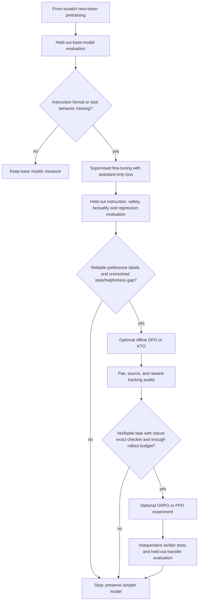

# Batch 7: Capability Development After Pretraining

Audited 2026-11-23. The base Transformer/evaluator remain unchanged. The host has 8.33 GB RAM, 5.80 GB available at batch start, no swap, two allowed logical CPUs and no NVIDIA device. System Python has no PyTorch; the existing 954 MiB isolated CPU PyTorch 2.15.0+cpu environment was reused. The corrected local SFT run peaked at 346,243,072 bytes RSS and did not install or download anything.

## Stage diagram



No post-training stage is mandatory. The stage diagram is a set of conditional experiments, not a recipe to apply all stages.

## Source map

The sources below were inspected at pinned repository heads. Commit SHAs and license identifiers are in [`REPOSITORY_LEDGER.csv`](../REPOSITORY_LEDGER.csv). A head SHA and audit date are recorded; last meaningful commit activity was not independently established for each repository. Upstream tests were inspected, not run. Paper claims, repository statements and local measurements are distinguished below.

| Project | Source-level observation | Cost, dependencies, license and fit |
|---|---|---|
| nanochat | [`scripts/chat_sft.py`](https://github.com/karpathy/nanochat/blob/92d63d4e8bb4df75c3b71618f31ddde2378b2bcd/scripts/chat_sft.py) renders chat IDs, masks non-assistant/padding labels, best-fit packs conversations, accumulates gradients, schedules optimizers and saves checkpoints. Validation includes BPB and ChatCORE. | MIT. Compact source reference, but source notes CPU/MPS do not have meaningful GPU MFU. An all-masked microbatch can produce NaN if the masked mean is not guarded; our local loss explicitly errors on zero active targets. |
| Hugging Face TRL | [`SFTTrainer`](https://github.com/huggingface/trl/blob/c50d104633099d9bd6314fbd24108c5554beb857/trl/trainer/sft_trainer.py) supports prompt-completion and conversational assistant-only masks plus packing; [`DPOTrainer`](https://github.com/huggingface/trl/blob/c50d104633099d9bd6314fbd24108c5554beb857/trl/trainer/dpo_trainer.py) scores chosen/rejected against policy/reference; [`KTOTrainer`](https://github.com/huggingface/trl/blob/c50d104633099d9bd6314fbd24108c5554beb857/trl/trainer/kto_trainer.py) uses desirable/undesirable labels; [`GRPOTrainer`](https://github.com/huggingface/trl/blob/c50d104633099d9bd6314fbd24108c5554beb857/trl/trainer/grpo_trainer.py) samples groups and calls reward functions/verifiers. | Apache-2.0. Broad Transformers/Accelerate/datasets stack and GPU-oriented paths; implementation/tests are useful references but not installed. Assistant-only loss relies on a chat template that produces correct masks. |
| PEFT | [`LoraConfig`](https://github.com/huggingface/peft/blob/af1ccdf262b9fe1ad8f0861ae10113a851ee5cbd/src/peft/tuners/lora/config.py) configures rank and scaling; LoRA adds trainable A/B projections on selected modules. | Apache-2.0. Reduces trainable parameters and optimizer state, not the frozen base weights or backward activation cost. Does not replace pretraining from scratch. |
| Unsloth | Current repository and integrations expose SFT, DPO and GRPO memory/kernel optimizations. | Apache-2.0. Specialized GPU paths; the survey did not independently benchmark kernels or validate all current integrations. Not a CPU dependency. |
| Axolotl | [`trainer.py`](https://github.com/axolotl-ai-cloud/axolotl/blob/de8549a4406327ab5311f7187a8afaa232645487/src/axolotl/utils/trainer.py) filters all-ignored-label examples, applies weighted CE and dispatches causal/RL trainers; docs wrap TRL and add multipack. | Apache-2.0. Transformers, Arrow/datasets, DeepSpeed/FSDP and optional vLLM create substantial dependency surface. |
| LLaMA-Factory | [`loader.py`](https://github.com/hiyouga/LLaMA-Factory/blob/8ebba0d07dd14fdb1d429c497f018c7dae2e44b7/src/llamafactory/data/loader.py) selects SFT, pairwise, feedback/KTO and packing paths. DPO code computes chosen/rejected and reference log-probabilities; PPO wires policy/reference/reward models. | Apache-2.0. Broad, fast-changing integration; inspected legacy PPO path rejects checkpoint resume. |
| OpenRLHF | [`train_ppo_ray.py`](https://github.com/OpenRLHF/OpenRLHF/blob/26494490bc237f6c3af62dab6117e6bbb0a78dba/openrlhf/cli/train_ppo_ray.py) wires actor, reference, reward, optional critic, Ray and rollout workers. | Apache-2.0. Multiple model roles and distributed/async GPU infrastructure; not suitable for this CPU experiment. |
| verl | [`ppo_trainer.yaml`](https://github.com/verl-project/verl/blob/7b6c9cc0e19de780ca52c0c35d5157348955a3dc/verl/trainer/config/ppo_trainer.yaml) configures actor/rollout, reference and critic; trainer has GAE/GRPO-style advantage paths. | Apache-2.0. Distributed/async design; source reference only. |
| Hugging Face open-r1 | [`grpo.py`](https://github.com/huggingface/open-r1/blob/5b6ff22b3fb7aa069c54866e517f39dfc3160e09/src/open_r1/grpo.py) and `rewards.py` include parsed arithmetic rewards, format rewards and code-test rewards through external sandbox providers. | Apache-2.0. Verifier fallback and sandbox failure paths need adversarial tests; do not execute generated code unsandboxed. |
| OpenR1-Math-220k | [Dataset card at pinned revision](https://huggingface.co/datasets/open-r1/OpenR1-Math-220k/blob/dc748648036c1ed619b020e056dc4b603eb39817/README.md) reports model-generated solutions for NuminaMath problems, Math-Verify filtering and a large-model judge for some unparseable cases. | Card says Apache-2.0; upstream NuminaMath source license/provenance needs separate review. The data files exceed 2 GiB and were not downloaded. Card methodology is repository-reported, not independently verified. |

### Objective and rollout differences

| Stage | Data and objective | Forward/model cost and main risk |
|---|---|---|
| SFT | Prompt-completion or chat messages; next-token cross entropy only on assistant/completion targets. | One trainable policy. Packing must preserve turn boundaries and mask padding; if packed examples can attend across boundaries, later examples see earlier examples. Wrong templates can mask all tokens or train on user/tool content. |
| DPO | Offline chosen/rejected response pairs; policy/reference log-probability ratio with a preference objective. | Train policy and score reference on both candidates (up to four sequence passes per pair, often combined); no rollout generation. Precomputed reference scores can remove resident reference inference during updates. Pair-label quality, length bias and reference mismatch matter. |
| KTO | Offline desirable/undesirable examples rather than pairs; objective uses KL/reference terms (default estimator depends on batch composition). | Policy and reference computations or precomputed scores; no rollout generation. Labels still need reliable semantics and balanced batches. |
| GRPO | Online prompt groups, sampled completions and relative rewards; custom deterministic verifiers are possible. | Generation tokens scale with group size G; policy update and often reference/KL scoring. No value critic is normally required, but rollout KV cache and a separate inference engine/model copy can dominate. Verifier bugs invite reward hacking. |
| PPO | Online rollouts, advantage estimation, policy and value updates, usually reference KL and reward model. | Actor + critic + reference + reward model roles; rollout, scoring and multiple optimization passes. Most memory/engineering burden here; reward and critic errors can destabilize updates. |

At a high level, SFT minimizes `-sum log pi(response_token | prompt, prior_response_tokens)` over unmasked assistant targets. DPO minimizes a pairwise logistic loss on the difference between chosen/rejected policy-vs-reference log-ratios, e.g. `-log sigmoid(beta * ((log pi_chosen - log pi_rejected) - (log ref_chosen - log ref_rejected)))`. KTO uses separate desirable/undesirable utilities with a reference/KL-derived baseline rather than a chosen/rejected pair. GRPO samples G outputs per prompt, normalizes verifier/reward scores within that group to form advantages, then applies a clipped policy-ratio objective and optional reference KL penalty. PPO also uses clipped policy ratios, but trains a value/critic and generally consumes reward-model scores plus reference-KL control. Exact loss variants differ by implementation/config; see pinned source files rather than treating these summaries as one standard implementation.

The inspected open-r1 verifier path uses parsed answer correctness, formatting, and test-based code rewards; code is delegated to configured sandbox providers. A parser failure, timeout or sandbox outage must not be silently rewarded as a correct answer. In source, GRPO's generation count and group size directly change token budget; DPO does not sample during its optimizer loop. TRL's trainer tests (`tests/test_sft_trainer.py`, `tests/test_dpo_trainer.py`, `tests/test_grpo_trainer.py`) were inspected but not run here.

**Paper claims:** DPO's paper derives an offline preference objective ([Rafailov et al.](https://arxiv.org/abs/2305.18290)); KTO presents learning from desirable/undesirable feedback ([Ethayarajh et al.](https://arxiv.org/abs/2402.01306)); GRPO is presented in DeepSeekMath ([paper](https://arxiv.org/abs/2402.03300)); DeepSeek-R1 reports reasoning/RL outcomes ([paper](https://arxiv.org/abs/2501.12948)). These outcomes were not reproduced in this Codespace. Source observations above describe code, not empirical superiority.

## Parameter, model-copy and memory estimate

Let P be parameter count, q the trainable adapter parameter count, A the activation/cache/workspace bytes, and assume full FP32 weights/gradients/Adam moments unless stated. The baseline estimate is about 4P weights + 4P gradients + 8P Adam moments = 16P bytes for a fully trained policy, before A and temporary allocations. A frozen FP32 inference model adds about 4P. These are lower-order capacity estimates, not peak-memory measurements; sequence activations, logits, optimizer temporaries, fragmentation and rollout KV cache add on top.

| Method | Model roles/copies | Approximate persistent memory before activations | GPU/rollout implication |
|---|---|---|---|
| Full SFT | 1 trainable policy | `16P + A` | One model role. A 1B model is about 16 GB FP32 baseline; 7B about 112 GB. Full training is multi-GPU or sharded at these sizes absent specialized quantization/offload. |
| LoRA SFT | 1 frozen base + trainable adapters | `bP + 16q + A`, where b=2 or 4 bytes per frozen weight | Lower optimizer state when q << P, but base weights and activations remain. A 7B BF16 base alone is about 14 GB. |
| DPO | Trainable policy + frozen reference, or precomputed reference scores | `16P + 4P + A` for FP32 resident reference; about `20P + A`. Can approach `16P + A` during updates if reference scores were safely precomputed. | No rollouts; chosen/rejected token work is roughly doubled for policy and reference scoring. 1B ~20 GB or 7B ~140 GB before activations in the resident FP32 estimate. |
| KTO | Policy + reference or stored reference scores | Same order as DPO; examples are unpaired but reference/KL work remains | No rollouts. Default KL estimator and batch construction are part of compute and correctness. |
| GRPO | Policy + optional reference + rollout engine (may share policy or be a separate copy); no critic in typical form | ~`20P + A` if policy/reference only; ~`24P + A` if separate FP32 rollout copy | Group size G multiplies generated completions/tokens and cache; reference KL adds scoring passes. 1B rough 20-24 GB; 7B 140-168 GB before rollout KV and activations. |
| PPO | Policy + value critic + reference + reward model | Roughly `16P + 16P + 4P + 4P = 40P + A` with FP32 trainable policy/critic and frozen reference/reward | 1B ~40 GB; 7B ~280 GB before rollouts/KV/activations. In practice sharding, offload, quantized/frozen models and shared trunks change this. |

With BF16 autocast and FP32 master parameters/Adam state, optimizer/parameter memory stays close to the FP32 16P model; activation bytes may fall. LoRA changes q, not the base model's P. A separate rollout model is not mathematically required by GRPO/PPO but commonly appears when high-throughput inference and training backends differ. Reference-logprob precomputation trades storage/data provenance for fewer resident model copies. No GPU capacity guarantee is made for a specific product; these estimates show why full DPO/RL was not attempted here.

## Tiny SFT, exact verifier and abstention experiment

The standalone [`capability_sft.py`](../experiments/capability_sft.py) reuses the unchanged TinyGPT architecture, with an experiment-only vocabulary of 40 and context 16. A prompt uses explicit `BOS USER ADD x y ASSISTANT` token IDs. The completion is either one exact sum-class token plus EOS, or an abstract labelled digit/carry sequence plus EOS. A missing operand is marked with a dedicated token and supervised to emit `ABSTAIN EOS`. The loss mask covers only completion tokens after the assistant marker, including EOS; user and role tokens and padding are excluded. A zero-target batch raises instead of producing NaN.

The held-out split has 80 unique training operand pairs and 20 disjoint held-out pairs; every answer value 0..18 occurs in training. Ten training missing-input examples mask the right operand; ten evaluation examples mask the left operand. Thus abstention must transfer across operand position. The independent exact checker computes the sum from operands and checks the full completion, including EOS. Unit tests cover correct/wrong sums, required abstention, no false success for a missing input, assistant-mask boundaries, and split disjointness.

The output-style comparison is one controlled but narrow hypothesis: on this one-digit task, do explicit `ONES/CARRY/TENS` labels improve generalization versus one concise answer token? Both use identical examples, seeds, batch size, update count (480), parameter count (14,560), model context, optimizer and same padded sequence compute. The verbose format has 580 assistant target tokens/example-set/epoch versus 180 for concise; it therefore has a different number of supervised output decisions. This is a token-ID arithmetic protocol, not natural-language chain of thought.

| Style | Mean train exact accuracy, 3 seeds | Mean held-out answer accuracy | Abstention recall on 10 missing-left cases | False abstention on held-out answerable cases | Mean train seconds |
|---|---:|---:|---:|---:|---:|
| Untrained initialization | 0 | 0 | 0 | 0 | N/A |
| Concise SFT | 0.833 | 0.583 (seed range 0.45-0.65) | 0.567 (range 0-1) | 0 | 2.03 s |
| Step-labelled SFT | 0.674 (range 0.367-0.878) | 0.367 (range 0.10-0.55) | 0.633 (range 0-1) | 0 | 2.13 s |

Both SFT formats improved over the untrained model on this narrow held-out set, but neither was reliable. Concise output had higher average answer accuracy; step labels did not show a gain and one seed performed poorly. Zero false abstentions is not enough: missing-input recall varied from zero to one after training, so model abstention was not calibrated or robust. A deterministic front-end verifier could enforce the obvious missing-operand case, but that is tool correctness rather than learned uncertainty. This toy does not support claims about language, coding or general reasoning.

The first attempt is preserved as [`capability_sft_tiny.json`](../experiments/results/capability_sft_tiny.json). Audit found a split bug: its held-out set contained 0+0, the only training target for answer value zero, making that answer class unseen. It was not used for the final comparison. Corrected 80/20 protocol/results are in [`capability_sft_tiny_v2.json`](../experiments/results/capability_sft_tiny_v2.json). Keeping the failed split visible is part of the experiment record.

The corrected 6-run study (two styles x three seeds) used 80 epochs x six minibatches, batch size 16, 480 updates, AdamW lr 0.003, no weight decay, global norm clip 1.0, one thread. It peaked at 346,243,072 bytes RSS and began with 5,274 MiB available. Total target tokens differed by format: 43,200 over three concise runs versus 139,200 over three step-labelled runs. Padded sequence length was fixed to make per-update model shape/compute comparable. Reproduce:

```sh
timeout 120s env OMP_NUM_THREADS=1 MKL_NUM_THREADS=1 OPENBLAS_NUM_THREADS=1 NUMEXPR_NUM_THREADS=1 PYTHONDONTWRITEBYTECODE=1 /tmp/b4-torch-venv/bin/python -m unittest -v research/experiments/test_capability_sft.py
timeout 120s env OMP_NUM_THREADS=1 MKL_NUM_THREADS=1 OPENBLAS_NUM_THREADS=1 NUMEXPR_NUM_THREADS=1 PYTHONDONTWRITEBYTECODE=1 /tmp/b4-torch-venv/bin/python research/experiments/capability_sft.py --config research/experiments/baseline_config.json --output research/experiments/results/capability_sft_tiny_v2.json --epochs 80 --batch-size 16 --seeds 11 23 37
```

## Candidate curriculum and decision

1. Continue next-token pretraining on licensed, curated data; preserve domain-balanced held-out evaluations.
2. Add SFT only when the base model lacks desired instruction format or response behavior. Train on carefully filtered demonstrations with assistant-only masks, deduplicated split boundaries and held-out task/source families.
3. Include verifiable math/code examples only after exact checkers are unit- and adversarial-tested. Mix them with general-language and instruction regressions so narrow task gains do not erase other behavior. Keep concise answers as the first baseline; test worked formats against concise outputs at matched examples, tokens and compute separately.
4. Add abstention examples with answerable, missing-evidence and conflicting-evidence cases; report abstention precision/recall and false-abstention rate. Keep deterministic evidence/verification tools responsible for claims they can actually settle.
5. Consider DPO/KTO only if curated preference labels target a real shortfall not captured by exact metrics. Compare offline preference tuning against SFT at equal data and compute, with a reference policy and held-out preference audit.
6. Consider GRPO/PPO only for a verifiable behavior where repeated rollouts produce a measurable held-out gain that simpler SFT cannot achieve. First test verifier false positives/negatives, reward hacking and cross-generator transfer. Do not run it because it is fashionable or because a CoT corpus exists.

**Evidence against a mandatory reasoning stage:** the tiny controlled comparison did not show a benefit from additional step labels; this result is weak and format-specific. There is no local DPO, KTO, PPO or GRPO experiment. Better reasoning is not guaranteed by adding chain-of-thought data, preferences or an RL stage. Require held-out accuracy, robustness, calibration/abstention, language/coding regression metrics and cost per correct answer before retaining any stage.
